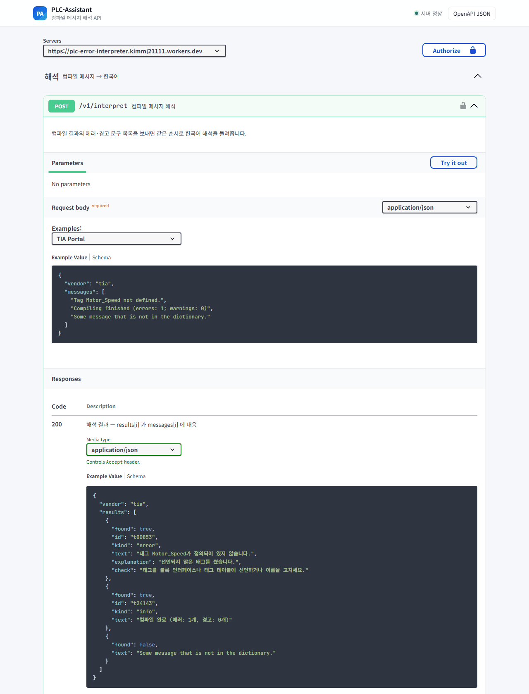

# PLC-Assistant

PLC 엔지니어를 위한 보조 도구 모음입니다. 도구마다 사용법을 아래에 정리했습니다.

| 도구 | 무엇을 하나 | 형태 |
| --- | --- | --- |
| [컴파일 메시지 해석 API](#1-컴파일-메시지-해석-api) | TIA Portal · GX Works3 컴파일 에러를 자연스러운 한국어 해석으로 | HTTP API |
| [TIA Portal 애드인](#2-tia-portal-애드인) | 하드웨어 목록 Excel 내보내기 · I/O 카드 정보 · PLC 데이터 목록(UDT · DB · 태그) · FB 출처 서명 · HMI 화면 가져오기 | TIA Portal 애드인 (V19 · V20 · V21) |

---

## 1. 컴파일 메시지 해석 API



컴파일 결과의 영어 에러·경고 문구를 그대로 보내면, 사전에서 찾아 다음을 돌려줍니다.

- **자연스러운 한국어 문장** — 태그명 · OB 번호 · 행/열 같은 값을 채우고, "을/를" 같은 조사도 맞춥니다.
- **쉬운 해석** — 무슨 상황인지 1~2문장.
- **확인할 것** — 바로 해 볼 조치.

| 영어 원문 | 응답 |
| --- | --- |
| `Tag Motor_Speed not defined.` | 태그 Motor_Speed가 정의되어 있지 않습니다. |
| `Use of MC-PreInterpolator (OB 68) requires the existence of MC_Servo (OB 92).` | MC-PreInterpolator(OB 68)를 쓰려면 MC_Servo(OB 92)가 있어야 합니다. |
| `The object HMITag with the name "Lamp_Run" was not found. in line 2, in column 35` | 이름이 "Lamp_Run"인 HMITag 객체를 찾을 수 없습니다. (2행 35열) |
| `Compiling finished (errors: 3; warnings: 1)` | 컴파일 완료 (에러: 3개, 경고: 1개) |

### 시작하기

1. **API 키**를 저장소 관리자에게 받습니다. 프로젝트(사용처)마다 따로 발급합니다.
2. 문서를 엽니다: **https://plc-error-interpreter.kimmj21111.workers.dev/docs**
   - 오른쪽 위 **Authorize** 에 키만 넣고(`Bearer` 는 쓰지 않음) → API 의 **Try it out** → **Execute**.
3. 코드에서는 모든 요청에 헤더를 붙입니다: `Authorization: Bearer <API 키>`

OpenAPI 명세(클라이언트 코드 생성용): `https://plc-error-interpreter.kimmj21111.workers.dev/openapi.json`

### 요청과 응답

```http
POST /v1/interpret
Authorization: Bearer <API 키>
Content-Type: application/json

{
  "vendor": "tia",
  "messages": [
    "Tag Motor_Speed not defined.",
    "Some message that is not in the dictionary."
  ]
}
```

```json
{
  "vendor": "tia",
  "results": [
    {
      "found": true,
      "id": "t00853",
      "kind": "error",
      "text": "태그 Motor_Speed가 정의되어 있지 않습니다.",
      "explanation": "선언되지 않은 태그를 썼습니다.",
      "check": "태그를 블록 인터페이스나 태그 테이블에 선언하거나 이름을 고치세요."
    },
    { "found": false, "text": "Some message that is not in the dictionary." }
  ]
}
```

| 필드 | 뜻 |
| --- | --- |
| `vendor` | `tia` (Siemens TIA Portal) · `gxw3` (Mitsubishi GX Works3) |
| `messages` | 컴파일 메시지 원문 배열. 문자열 또는 `{ "text": "…" }`. 최대 500개 · 하나당 4,000자 |
| `results[i]` | `messages[i]` 의 결과 — **같은 순서 · 같은 개수** |
| `found` | 사전에서 찾았는지. 못 찾으면 `text` 에 보낸 원문이 그대로 옵니다 |
| `kind` | `error` · `warning` · `info` (예: "컴파일 완료 …" 요약 줄은 `info`) |
| `text` | 화면에 그대로 보여줄 문구 |
| `explanation` · `check` | 쉬운 해석 · 확인할 것 (있을 때만) |
| `id` | 사전 항목 ID — 수정 요청에 씁니다 |

### 사용 팁

- 한 번 컴파일한 결과를 **한 요청에 모아서** 보내세요. 메시지마다 따로 부르지 않습니다.
- 첫 호출은 몇 초 걸릴 수 있습니다. 타임아웃은 **10초 이상**.
- 실패(네트워크 · 5xx)하면 원문을 그대로 보여주세요. 해석은 부가 기능입니다.
- TIA Openness 컴파일 결과(`CompilerResultMessage`)라면 `Description` 만 보내면 됩니다.
  `Path`(블록 · 네트워크 위치)는 번역할 필요 없이 그대로 보여주면 됩니다.

### 예제

**curl**
```bash
curl -X POST https://plc-error-interpreter.kimmj21111.workers.dev/v1/interpret \
  -H "Authorization: Bearer $API_KEY" \
  -H "Content-Type: application/json" \
  -d '{"vendor":"tia","messages":["Tag Motor_Speed not defined."]}'
```

**TypeScript**
```ts
const res = await fetch('https://plc-error-interpreter.kimmj21111.workers.dev/v1/interpret', {
  method: 'POST',
  headers: { Authorization: `Bearer ${API_KEY}`, 'Content-Type': 'application/json' },
  body: JSON.stringify({ vendor: 'tia', messages }),
  signal: AbortSignal.timeout(10_000),
});
const { results } = await res.json(); // results[i] ↔ messages[i]
```

**Python**
```python
import httpx

r = httpx.post(
  'https://plc-error-interpreter.kimmj21111.workers.dev/v1/interpret',
  headers={'Authorization': f'Bearer {API_KEY}'},
  json={'vendor': 'tia', 'messages': messages},
  timeout=10,
)
results = r.json()['results']
```

**C#**
```csharp
using var http = new HttpClient { Timeout = TimeSpan.FromSeconds(10) };
http.DefaultRequestHeaders.Authorization = new AuthenticationHeaderValue("Bearer", apiKey);
var res = await http.PostAsJsonAsync(
  "https://plc-error-interpreter.kimmj21111.workers.dev/v1/interpret",
  new { vendor = "tia", messages });
var body = await res.Content.ReadFromJsonAsync<JsonElement>();
```

### 번역 수정 요청

해석이 어색하거나 틀렸으면 `POST /v1/feedback` 으로 고친 문구를 보내 주세요. 검토 후 사전에 반영합니다.

```json
{
  "vendor": "tia",
  "messageId": "t00853",
  "text": "태그 {1}이(가) 선언되지 않았습니다.",
  "comment": "현장에서는 '선언'을 더 씁니다."
}
```

`messageId` 는 응답의 `id` 입니다. 사전에 없던 메시지라면 `messageId` 없이 `message` 에 원문을 넣으세요.

### 에러 응답

모든 에러는 `{"error": "<코드>"}` 입니다.

| HTTP | 코드 | 뜻 |
| --- | --- | --- |
| 400 | `BODY_INVALID` · `VENDOR_INVALID` · `MESSAGES_EMPTY` · `MESSAGE_INVALID` | 요청 형식 |
| 400 | `FIELD_INVALID` · `FEEDBACK_EMPTY` | 수정 요청 형식 |
| 401 | `UNAUTHORIZED` | API 키 없음 또는 틀림 |
| 404 | `MESSAGE_NOT_FOUND` · `NOT_FOUND` | 없는 사전 ID · 없는 경로 |
| 413 | `MESSAGES_TOO_MANY` | 메시지 500개 초과 |
| 500 | `INTERNAL` | 서버 내부 에러 |

### 데이터 처리

- 응답에는 한국어 해석만 담기며, 사전의 영어 원문은 공개하지 않습니다.
- 해석 요청으로 보낸 메시지는 저장하지 않습니다.
- 사전에 없던 메시지는 보강을 위해 기록하되, **사전 문장에 나오는 일반 단어만 남기고** 태그명 · PLC 이름 ·
  경로 · 숫자는 지워서 저장합니다. 예: `Tag Motor_Speed not defined.` → `Tag {} not defined`
- 수정 요청(`/v1/feedback`)에 넣은 내용은 검토를 위해 저장합니다.

---

## 2. TIA Portal 애드인

<!-- 이미지: images/tia-addin/menu.png — 프로젝트 트리 우클릭 › Add-Ins › PLC-Assistant -->

TIA Portal 프로젝트 트리에서 우클릭 › **Add-Ins › PLC-Assistant** 로 쓰는 메뉴입니다.

| 메뉴 | 어디서 | 하는 일 |
| --- | --- | --- |
| 하드웨어 목록 Excel 내보내기 | 프로젝트 노드 | 프로젝트의 모든 디바이스를 Excel 로 |
| 하드웨어 목록 Excel 내보내기 (선택 디바이스) | 디바이스 노드 (여러 개 선택 가능) | 고른 디바이스만 Excel 로 |
| I/O 카드 정보 보기 | 디바이스 · 랙 · 모듈 노드 (하나) | 그 스테이션 슬롯에 꽂힌 모듈을 표로 — 컨트롤러면 IO 시스템의 분산 I/O 까지 |
| PLC 데이터 목록 Excel 내보내기 (UDT · DB · 태그) | 프로젝트 노드 (전체 PLC) · PLC · 디바이스 노드 | UDT · DB · PLC 태그 · 사용자 상수를 Excel 로 |
| PLC-Assistant 서명 추가 | FB 블록 (여러 개 선택 가능) | 블록에 출처 서명을 남김 |
| HMI 화면 가져오기 (JSON) | WinCC Unified 의 HMI 장치 노드 | 화면 JSON 파일을 Unified 화면으로 넣음 |

### 설치

지원 버전: **TIA Portal V19 · V20 · V21**

1. [Releases](../../releases) 에서 쓰는 TIA 버전의 파일을 받습니다 —
   `PlcAssistantAddIn-V19.addin` · `PlcAssistantAddIn-V20.addin` · `PlcAssistantAddIn-V21.addin`.
   버전이 맞지 않으면 TIA 가 애드인을 읽지 못합니다.
2. 아래 폴더에 넣습니다 (`Vxx` 는 TIA 버전, 폴더가 없으면 만듭니다).
   ```
   %APPDATA%\Siemens\Automation\Portal Vxx\UserAddIns\
   ```
3. TIA Portal 을 다시 시작합니다. 켜져 있을 때 넣은 파일은 인식되지 않습니다.
4. 오른쪽 **Add-Ins** 태스크 카드에서 받은 파일(예: `PlcAssistantAddIn-V21.addin`)의 Status 를 **Activate** 로 바꿉니다.
   새 버전으로 바꿀 때는 옛 파일을 지우고 넣은 뒤 다시 Activate 합니다.
   처음 한 번만 하면 됩니다. 요청 권한은 TIA 읽기/쓰기와 파일 쓰기 · 내보낸 파일 열기입니다.

<!-- 이미지: images/tia-addin/activate.png — Add-Ins 태스크 카드에서 Activate -->

삭제는 `UserAddIns` 폴더에서 파일을 지우고 TIA 를 다시 시작하면 됩니다.

### 하드웨어 목록 Excel 내보내기

- 저장 위치: `<프로젝트 폴더>\UserFiles\PlcAssistantAddIn\<프로젝트>_hardware_<날짜_시각>.xlsx`
  (프로젝트 경로를 읽을 수 없는 경우엔 `%TEMP%\PlcAssistantAddIn\project_hardware_<날짜_시각>.xlsx`)
- 저장 후 바로 열지 묻습니다.
- 시트
  - **Hardware** — 디바이스 · 모듈 · 깊이 · 슬롯 · 분류 · 주문번호 · 버전 · TypeIdentifier · I/O 주소
  - **Network** — 디바이스 · 모듈 · 인터페이스 · IP 주소 · 서브넷 마스크 · 서브넷 · IO 컨트롤러/디바이스 시스템

<!-- 이미지: images/tia-addin/hardware-excel.png -->

### I/O 카드 정보 보기

랙 슬롯에 꽂힌 모듈을 창에 표로 보여 줍니다. 디바이스 노드, 또는 장치 보기의 랙 · CPU · 모듈을 우클릭 ›
**Add-Ins › PLC-Assistant › I/O 카드 정보 보기**.

- 칸: 스테이션 · IO 시스템 · 랙 · 슬롯 · 모듈 · 종류 · 채널 · 입력 주소 · 출력 주소 · 주문번호 · 펌웨어 · 주석
- 종류와 채널은 모듈의 채널로 셉니다 — 예: `DI 16` → 디지털 I/O, `AI 8` → 아날로그 I/O. CPU · 헤드 모듈은 그렇게 적습니다.
- 주소는 바이트 범위입니다 (`0..1` = I/Q 0~1 바이트).
- **컨트롤러에서 부르면** 그 PROFINET / PROFIBUS IO 시스템에 물린 분산 I/O 스테이션의 카드도 이어서 나옵니다.
- 창에서 **복사**(고른 줄, 없으면 전부 — Excel 에 그대로 붙습니다) · **Excel 로 저장** 을 할 수 있습니다.
  저장 창은 `<프로젝트 폴더>\UserFiles\PlcAssistantAddIn\` 에서 열립니다.

<!-- 이미지: images/tia-addin/io-cards.png -->

### PLC 데이터 목록 Excel 내보내기 (UDT · DB · 태그)

프로젝트 노드(모든 PLC) · PLC 디바이스 노드 · PLC 아래 폴더를 우클릭 ›
**Add-Ins › PLC-Assistant › PLC 데이터 목록 Excel 내보내기 (UDT · DB · 태그)**.

- 저장 위치: `<프로젝트 폴더>\UserFiles\PlcAssistantAddIn\<프로젝트>_plcdata_<날짜_시각>.xlsx` — 저장 후 바로 열지 묻습니다.
- 시트
  - **요약** — PLC 별 개수
  - **UDT** — 폴더 · 이름 · 멤버 수 · 제목 · 주석 · **쓰는 곳**(그 UDT 를 쓰는 DB · UDT · PLC 태그와 개수 — 0 이면 안 쓰는 UDT)
  - **UDT 멤버** — 구조 안쪽까지 `Alarm.Code` 처럼 펼침 · 데이터 타입 · 시작값 · 주석
  - **DB** — 폴더 · 이름 · 번호 · 종류(글로벌 · 인스턴스 · 배열 DB) · 인스턴스의 FB / 배열 DB 의 타입 · 접근(최적화 · 표준) · 멤버 수 · 제목 · 주석
  - **DB 멤버** — 글로벌 · 배열 DB 의 멤버 (UDT 안쪽까지) · 데이터 타입 · 시작값 · 리테인 · 주석
  - **PLC 태그** — 태그 테이블 · 이름 · 데이터 타입 · 주소 · 주석 · HMI 접근 · 표시 · 쓰기
  - **사용자 상수** — 태그 테이블 · 이름 · 데이터 타입 · 값 · 주석
- 인스턴스 DB 는 목록에만 나옵니다(멤버는 FB 인터페이스 그대로입니다).
- "쓰는 곳" 은 DB · UDT 멤버와 PLC 태그에서 셉니다. FB · FC 인터페이스 안의 쓰임은 세지 않습니다.
- **컴파일하지 않은 블록 · UDT 는 멤버를 읽지 못합니다** — TIA 가 내보내기를 거절합니다. 그 줄의 '상태' 칸에 적히니,
  PLC 를 컴파일한 뒤 다시 내보내세요.
- 블록이 많으면 시간이 걸립니다. 진행 창에서 취소하면 읽은 데까지 저장합니다. 프로젝트는 바꾸지 않습니다.

<!-- 이미지: images/tia-addin/plc-data-excel.png -->

### PLC-Assistant 서명 추가

FB 에 "이 블록은 PLC-Assistant 로 만들었다"는 출처를 남깁니다. 코드(네트워크)는 건드리지 않아
컴파일 상태에 영향이 없습니다.

| TIA 버전 | 남는 서명 |
| --- | --- |
| V21 | 블록 제목 앞 `[출처: PLC-Assistant]` · 주석 첫 줄 `출처: PLC-Assistant · 서명 <일시>` · 헤더 Author/Family `PLCASST` |
| V19 · V20 | 헤더 Author/Family `PLCASST` (이 버전 API 에는 제목 · 주석 설정이 없습니다) |

- 이미 서명된 블록은 건너뜁니다.
- 노하우 보호 블록과 FB 가 아닌 블록은 서명하지 않습니다.
- 끝나면 서명 · 건너뜀 · 실패 개수를 보여 줍니다. 실패 상세는 `%TEMP%\PlcAssistantAddIn\sign.log`.

<!-- 이미지: images/tia-addin/sign.png -->

### HMI 화면 가져오기 (JSON)

웹 편집기에서 그려 내보낸 화면 파일(`<화면 이름>.screen.json`)을 WinCC Unified 화면으로 넣습니다.
WinCC Unified 는 화면을 파일로 가져오는 기능이 없어서, 애드인이 파일을 읽어 화면과 항목을 하나씩 만듭니다.

1. 프로젝트 트리에서 **HMI 장치 노드**(예: `HMI_1 [MTP1200 Unified Comfort]`)를 우클릭 ›
   **Add-Ins › PLC-Assistant › HMI 화면 가져오기 (JSON)**.
2. 화면을 넣을 폴더를 고릅니다. 프로젝트의 화면 폴더가 트리로 나옵니다.
   - 맨 위의 **Screens (최상위)** 를 고르면 폴더 없이 들어갑니다.
   - **새 폴더** 칸에 이름을 적으면 고른 폴더 아래에 그 폴더를 만들어 넣습니다.
3. 화면 파일을 고릅니다 (여러 개 선택 가능).
4. 끝나면 화면별로 만든 항목 수와 넣지 못한 것을 보여 줍니다.

화면 폴더를 직접 우클릭해서는 쓸 수 없습니다 — TIA Portal 이 WinCC Unified 화면 폴더에서는 애드인 메뉴를 열어 주지 않습니다.
화면 파일에는 폴더가 적혀 있지 않고, 넣는 곳은 2번에서 고른 폴더로만 정해집니다.

- 같은 이름의 화면이 있으면 **고칩니다** — 같은 이름의 항목은 파일의 값으로 바뀌고, 파일에 없는 항목은 그대로 둡니다.
  고치기 전에 먼저 묻습니다.
- 화면 이름은 폴더별이 아니라 **HMI 전체에서 하나뿐**이어야 합니다. 같은 이름의 화면이 다른 폴더에 있으면
  고른 폴더에 새로 만들 수 없어서, 있는 자리에서 고칠지 · 건너뛸지 · 취소할지 묻습니다. 폴더는 옮기지 않습니다.
- 파일에 든 그림(svg · png · jpg · bmp · gif)은 프로젝트 그래픽으로 먼저 들어갑니다. 같은 이름의 그래픽은 덮어씁니다.
- 이름으로만 가리킨 그래픽과 페이스플레이트는 프로젝트에 이미 있어야 합니다.
- **SVG 위젯**(동적 SVG 위젯 `.svghmi`)이 화면에 있으면 파일에 든 위젯 파일을 프로젝트의 `UserFiles\SVGControls\` 에
  먼저 씁니다(0.3.1 부터). 내용이 같은 파일은 건드리지 않고, 같은 위젯 이름의 파일이 이미 있으면 그것을 씁니다.
  인터페이스 값은 TIA 의 타입(불 · 숫자 · 색 · 글자)으로 바꿔 넣습니다.
- TIA 가 아직 모르는 위젯이면 그 항목만 빠집니다. 화면 편집기 도구 상자 › **Dynamic widgets** 에서 새로 고침한 뒤
  같은 파일을 다시 가져오세요(TIA Portal 이 이 새로 고침을 애드인에 열어 주지 않습니다).
- 태그 연결과 이벤트 스크립트도 함께 들어갑니다. 태그는 프로젝트에 있는 HMI 태그 이름이어야 합니다.
- 속성 하나가 거절돼도 멈추지 않고 나머지를 넣습니다. 넣지 못한 것 전체는 `%TEMP%\PlcAssistantAddIn\hmi-import.log`.
- **프로젝트를 저장하지 않습니다.** 화면을 확인한 뒤 직접 저장하세요.

<!-- 이미지: images/tia-addin/hmi-import.png -->

### 문제 해결

| 증상 | 확인할 것 |
| --- | --- |
| Add-Ins 메뉴에 안 보임 | TIA 를 다시 시작했는지, Add-Ins 태스크 카드에서 Activate 했는지, 받은 파일이 TIA 버전과 맞는지 |
| 서명 메뉴가 안 보임 | FB 만 선택했는지 (다른 종류가 섞이면 메뉴가 숨겨집니다) |
| I/O 카드 메뉴가 안 보임 | 디바이스 · 모듈을 하나만 골랐는지 |
| PLC 데이터 Excel 에 멤버가 비어 있음 | 그 줄의 '상태' 칸 — 대개 컴파일하지 않은 블록입니다. PLC 를 컴파일한 뒤 다시 내보내세요 |
| HMI 화면 가져오기 메뉴가 안 보임 | HMI 장치 노드를 우클릭했는지(화면 폴더에서는 보이지 않습니다), WinCC Unified 장치인지(Comfort/Advanced 패널은 대상이 아닙니다), 노드를 하나만 골랐는지 |
| 위젯 항목이 빠짐 ("Dynamic widgets 새로 고침") | 위젯 파일은 이미 들어갔습니다. 도구 상자 › Dynamic widgets 에서 새로 고침한 뒤 같은 화면 파일을 다시 가져오세요 |
| 내보내기 실패 | 프로젝트 폴더 쓰기 권한 · `%TEMP%\PlcAssistantAddIn\sign.log` |
